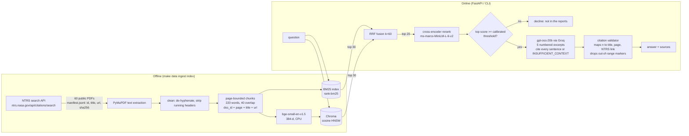

# Mars Mission Research Assistant

A retrieval-augmented question-answering system over **60 real NASA Technical Reports Server (NTRS) documents** on human missions to Mars: radiation, life support, spacecraft and habitat design, mission architecture, entry/descent/landing (EDL), crew health and in-situ resource use.
Ask "Why do Mars landers need supersonic retropropulsion?" and it answers in a few sentences, cites **report title, page number and NTRS link** for every claim, and **declines** when the reports don't contain the answer (for example "When did someone last go to the Moon?").

Hybrid BM25 + dense retrieval fused with Reciprocal Rank Fusion, a cross-encoder reranker that also drives a calibrated refusal gate, an LLM constrained to cite numbered excerpts, a FastAPI service with a web UI and CLI, Docker, CI with an offline eval gate, and an evaluation on a 50-question golden set (Ragas + own citation / refusal / latency metrics).

Author: Rakesh Burla (B.Tech Mechanical Engineering, RGUKT Basar) · `burlarakesh1458-sys`

<!-- RESULTS_START -->
## Results

All numbers below are measured by the scripts in this repo; full tables in [`reports/RESULTS.md`](reports/RESULTS.md).

**Retrieval** (40 answerable questions, 2391 chunks)

| Retriever | page hit@5 | page MRR@10 | doc hit@5 | latency p50 |
|---|---|---|---|---|
| bm25 | 0.950 | 0.849 | 1.000 | 10 ms |
| dense | 0.875 | 0.701 | 0.950 | 71 ms |
| hybrid_rrf | 0.900 | 0.819 | 0.975 | 87 ms |
| hybrid_rrf+rerank | 0.800 | 0.706 | 0.975 | 4,061 ms |
| dense+rerank | 0.750 | 0.704 | 0.950 | 4,254 ms |
| hybrid_rrf+rerank_fused | 0.925 | 0.801 | 1.000 | 4,385 ms |

**End-to-end** (`rerank_fused`, 26 golden questions: 18 answerable, 8 unanswerable)

| Metric | Value |
|---|---|
| Refusal accuracy (all 26) | 96.2% |
| Unanswerable correctly declined | 100.0% |
| Answerable wrongly declined | 5.6% |
| Citation accuracy, page level (17 answered) | 100.0% |
| Citation accuracy, report level | 100.0% |
| Latency p50 / p95, end-to-end as measured | 5,493 ms / 7,900 ms |
| Latency p50 / p95, excl. rate-limit waits | 5,350 ms / 6,620 ms |
| Latency p50, retrieval + rerank (CPU, 1 thread) | 5,031 ms |

> **Partial run: 26 of 50 golden questions.** Every free Groq model in the fallback chain hit its 200k tokens/day cap (shared with other projects on the same key) before the remaining 24 could be answered; the runner is resumable (`make eval-e2e` continues where it stopped). No numbers are extrapolated.

Latency was measured on a shared 2-vCPU sandbox with 1 torch thread while other jobs ran; the cross-encoder rerank of 20 candidates is most of the retrieval time.

Answered by: `retrieval_gate (no LLM call)` 8, `openai/gpt-oss-120b` 6, `openai/gpt-oss-20b` 5, `qwen/qwen3.8-27b` 5, `openai/gpt-oss-safeguard-20b` 2

**Ragas** (non-LLM metrics only; LLM-judged faithfulness not run, no judge quota left): nonllm_context_precision 0.786 (n=18); nonllm_context_recall 0.690 (n=18)

### Worked examples (25 of 26 correct)

**q01. Which turbulence model with the Catris-Aupoix compressibility correction is used in the NASA FUN3D solver for the Mars supersonic retropropulsion investigation?**

- Expected: Spalart-Allmaras (gold: NTRS 20210024976 p. [5])
- Got: The NASA FUN3D solver uses the Spalart‑Allmaras turbulence model with the Catris‑Aupoix compressibility correction. [1]
  - [1] Computational Investigation of the Effect of Chemistry on Mars Supersonic Retropropulsion Environments, p. 5 — https://ntrs.nasa.gov/citations/20210024976
- Answered by: `openai/gpt-oss-20b`
- Top rerank score: 6.03

**q02. In the Sabatier reactor system integration testing, what was the constant ratio of external H2 distribution to the main port, window sweep port, and view sweep port?**

- Expected: 56% to the main port, 35% to the window sweep port, and 9% to the view sweep port (gold: NTRS 20100036570 p. [9])
- Got: The external hydrogen was distributed to the ports in a fixed ratio of 56 % to the main port, 35 % to the window sweep port, and 9 % to the view sweep port. [2]
  - [2] Sabatier Reactor System Integration with Microwave Plasma Methane Pyrolysis Post-Processor for Closed-Loop Hydrogen Recovery, p. 9 — https://ntrs.nasa.gov/citations/20100036570
- Answered by: `openai/gpt-oss-20b`
- Top rerank score: 6.46

**q42. What is the price of a ticket for a SpaceX Starship flight to Mars?**

- Expected: decline (not in the reports)
- Got: DECLINED (low_relevance(top_rerank=-9.71<-6.10))
- Top rerank score: -9.71

### Failed examples (all failures are listed in reports/RESULTS.md)

**q16. What is the total trip duration in days for the 50,000 kg payload Mars cargo mission departing Earth on 2028-03-26 and arriving on 2030-01-30?**

- Expected: 675.0 days (gold: NTRS 20160010261 p. [32])
- Got: DECLINED (llm_declined)
- Answered by: `qwen/qwen3.8-27b`
- Top rerank score: 6.27

<!-- RESULTS_END -->

## Architecture



## Data provenance

* Source: NASA Technical Reports Server public search API `https://ntrs.nasa.gov/api/citations/search` (verified working; no key needed).
* `scripts/fetch_corpus.py` runs 19 topic queries (radiation, life support, spacecraft design, mission planning, EDL, crew health, ISRU), keeps only records that are `distribution=PUBLIC`, `disseminated=DOCUMENT_AND_METADATA` and have a PDF, round-robins across topics, and skips files over 12 MB or with fewer than 3 / more than 80 pages.
* Result: **60 reports, 1,083 pages, 1993-2026** (34 conference papers, 14 presentations, plus technical memoranda, preprints and manuscripts). Every file's NTRS id, title, citation URL, PDF URL, topic, year, page count and SHA-256 is in `data/manifest.jsonl`; the full list is in [`docs/CORPUS.md`](docs/CORPUS.md).
* The PDFs themselves are not committed (`make data` re-downloads them). The extracted chunks (`data/chunks.jsonl`, 2,391 chunks) are committed so tests and the CI eval gate run without downloading anything.

## Design decisions

| Decision | Why |
|---|---|
| **Chunks never cross a page** | The citation must name an exact page. A chunk that spans pages 4-5 can't be cited precisely. Cost: some chunks are short. |
| **Strip lines repeated on 40%+ of pages** | NTRS PDFs carry running headers ("NASA/TM-...", distribution notices) that would otherwise dominate BM25 and embeddings. |
| **BM25 + dense, fused with RRF (k=60)** | Technical questions contain exact tokens (CO2, BNTEP, DRA 5.0, 92 kWe) that BM25 matches and embeddings blur; paraphrased questions need the dense side. RRF needs no score calibration between the two. |
| **bge-small-en-v1.5 + MiniLM cross-encoder** | Both run on 2 CPU cores with 1 thread; the whole stack fits in < 1 GB RAM. |
| **Reranker score doubles as the refusal signal** | A cross-encoder score is a calibrated-enough relevance estimate; if even the best excerpt scores below the threshold, the question is declined *before* spending an LLM call. The threshold is fit on a separate 16-question calibration set (`eval/calibration.jsonl`), never on the golden set. |
| **Two refusal layers** | The gate catches off-topic questions cheaply; the prompt's `INSUFFICIENT_CONTEXT` rule catches on-topic questions whose specific fact is missing. |
| **Numbered excerpts + validator** | The model cites `[n]`; code maps `n` back to report/page/link and deletes any marker that points outside the excerpts, so a printed citation always resolves to a real page that was in the prompt. |
| **On-disk LLM cache + resumable eval files** | Groq's free tier allows 8k tokens/minute and 200k tokens/day per model. Every answer and judge score is appended as it finishes, so a run killed by a rate limit or a sandbox restart resumes where it stopped. |
| **Provider fallback chain** | `gpt-oss-20b` on Groq, then the same weights on NVIDIA Build, then `gpt-oss-120b`, `qwen3.8-27b` and `gpt-oss-safeguard-20b` on Groq (each has its own daily quota). A daily-quota 429 moves straight to the next provider; a per-minute 429 waits the time Groq asks for; a 413 "request larger than the 2,000 TPM cap" (safeguard) retries with `max_tokens` shrunk to fit. The model that answered is recorded per question. |
| **Different model drafted the questions** | Golden questions were drafted by `qwen3.8-27b`, answers come from `gpt-oss-20b`, to avoid a model grading its own phrasing. |

## Evaluation set

* `eval/golden.jsonl`: **50 questions, 40 answerable + 10 unanswerable.**
  * 32 answerable questions were drafted by an LLM from one randomly sampled chunk each (`scripts/draft_golden.py`, 45 drafts; 9 were self-flagged as unusable reference lists / bios) and then reviewed by hand: `scripts/finalize_golden.py` records which were kept, which reference answer was edited, and which 4 were moved to the calibration set. 8 more were written by hand from specific pages.
  * Known bias: LLM-drafted questions reuse the wording of their source chunk, which flatters lexical retrieval (BM25). The 8 hand-written questions are paraphrased more freely.
  * Gold location = every (report, page) whose text contains the evidence quote. Six questions have two valid locations because NTRS holds both a paper and its slide deck (e.g. DRA 5.0, the BNTEP 1-year mission); citing either counts.
  * 10 unanswerable questions: the video's "When did someone last go to the Moon?", plus false-premise, near-domain (Perseverance landing date, Starship ticket price) and off-topic questions. Each was checked against the corpus text.
* `eval/calibration.jsonl`: 8 answerable + 8 unanswerable questions, disjoint from the golden set, used only to set the refusal threshold.

## How to run

```bash
# 1. environment (CPU only)
python -m venv .venv && . .venv/bin/activate
pip install torch==2.15.0 --index-url https://download.pytorch.org/whl/cpu
pip install -r requirements.txt -r requirements-eval.txt -r requirements-dev.txt
export PYTHONPATH=src OMP_NUM_THREADS=1 GROQ_API_KEY=...      # optional fallback: NVIDIA_API_KEY

# 2. data (chunks.jsonl is committed; `make data ingest` rebuilds it from NTRS)
make index            # embeddings + Chroma (about 25 min on 1 CPU thread; embeddings are cached and resumable)
make calibrate        # refusal threshold -> eval/refusal_threshold.json

# 3. use it
python -m marsrag.cli ask "What radiation dose would a 700 to 900 day Mars mission give the crew?"
python -m marsrag.cli search "supersonic retropropulsion" --mode bm25
make serve            # http://localhost:8000  (web UI, POST /ask, GET /search, /reports, /eval, /docs)

# 4. evaluate
make eval-retrieval   # BM25 vs dense vs hybrid vs +rerank, no LLM
make eval-e2e         # answers, citation + refusal accuracy, latency (resumable)
make eval-ragas       # Ragas metrics
python scripts/make_report.py   # -> reports/RESULTS.md
make test lint eval-gate

# Docker
docker build -t marsrag . && docker run -p 8000:8000 -e GROQ_API_KEY=$GROQ_API_KEY marsrag
```

## Repository layout

```
src/marsrag/        config, ingest (PDF->chunks), retrieval (BM25, Chroma, RRF, reranker),
                    llm (cached, retrying OpenAI-compatible client), pipeline (gate, prompt, citations),
                    api (FastAPI), cli, static/index.html (web UI), eval/ (metrics, runners, Ragas)
scripts/            fetch_corpus, draft_golden, finalize_golden, calibrate, run_pipeline,
                    make_report, check_eval_gate, corpus_table
data/               manifest.jsonl (provenance), chunks.jsonl, embeddings.npz
eval/               golden.jsonl, calibration.jsonl, refusal_threshold.json, gate.json
reports/            retrieval_eval.json, e2e_eval.json, ragas_eval.json, answers_*.jsonl, RESULTS.md
tests/              pytest suite (no network, no models)
```
